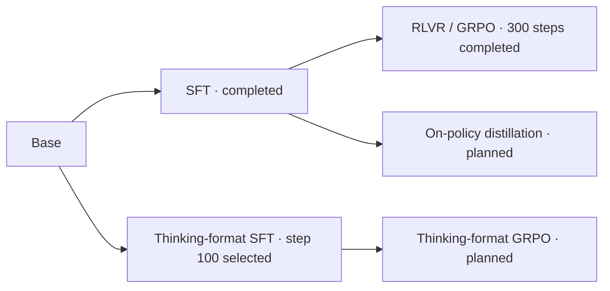
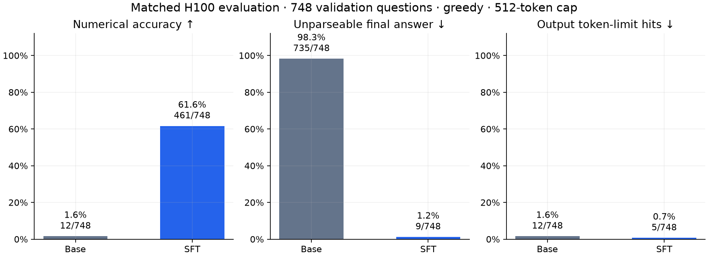
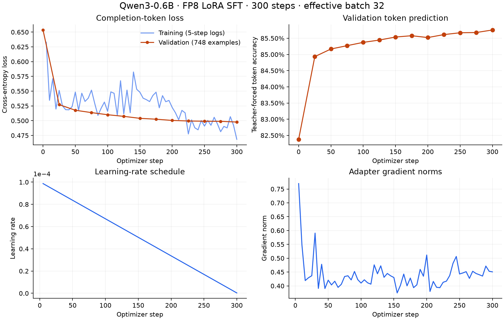
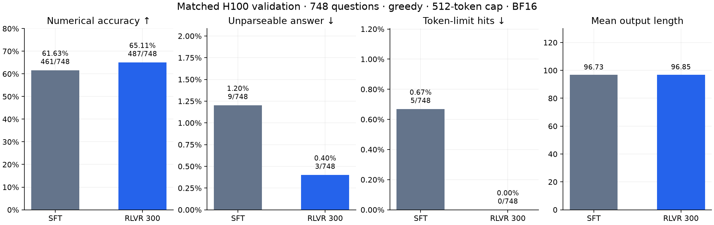
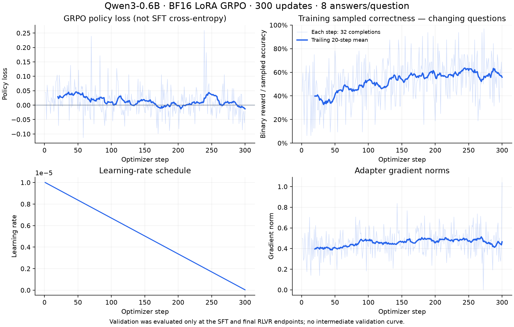
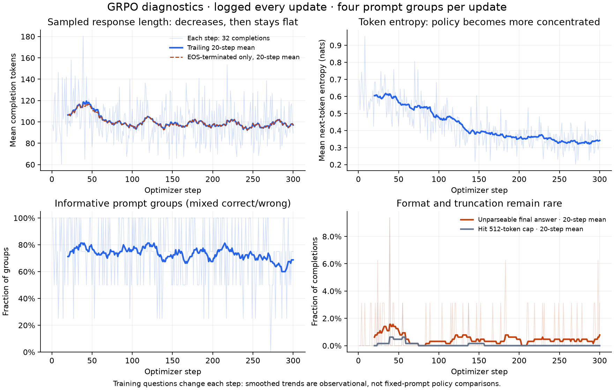
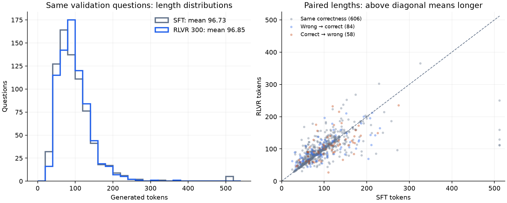
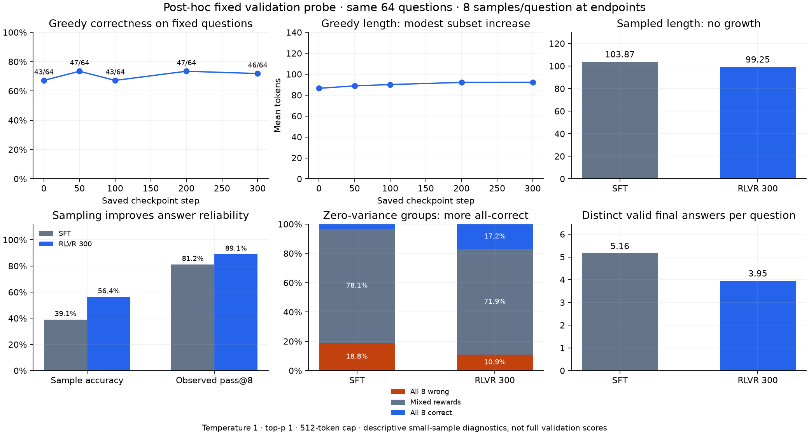
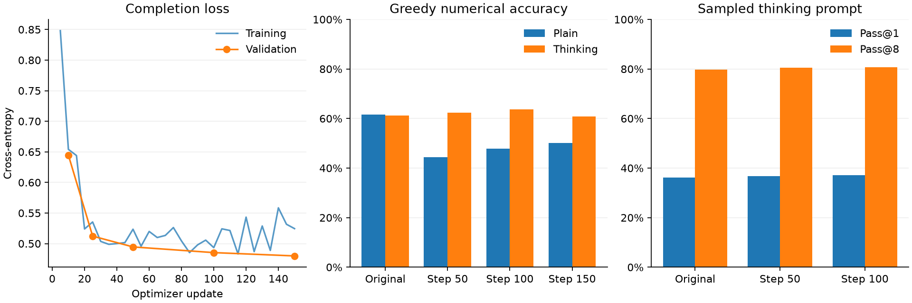

# Qwen3-0.6B-Base Post-Training

A small, reproducible GSM8K experiment comparing **base, SFT, SFT → RLVR, and SFT → on-policy distillation**. The original plain-format SFT and its 300-step RLVR continuation are complete. Thinking-format SFT stopped after evaluating step 150 and selected step 100 for a future GRPO run.



## Results: SFT learns the task and answer format

Matched evaluation on **all 748 validation questions**: identical prompts and question order, greedy decoding, 512 new tokens maximum, batch 64, BF16 inference on the same H100. Dataset hashes and generation settings were checked. **The official test set remains untouched.**

| Model | Numerical accuracy | Unparseable final answer | Token-limit hits | Mean output tokens |
| --- | ---: | ---: | ---: | ---: |
| Base | 1.60% (12/748) | 98.26% (735/748) | 1.60% (12/748) | 235.8 |
| SFT | **61.63% (461/748)** | **1.20% (9/748)** | **0.67% (5/748)** | **96.7** |
| SFT → RLVR · 25-step pilot | **62.97% (471/748)** | **0.80% (6/748)** | **0.40% (3/748)** | **95.7** |
| SFT → RLVR · 300 steps | **65.11% (487/748)** | **0.40% (3/748)** | **0.00% (0/748)** | **96.9** |
| SFT → on-policy distillation | Planned | — | — | — |



- **Formatting is a major part of the gain.** Scoring extracts the last complete matching `<final>…</final>` tag and compares its normalized number exactly; a nonnumeric last tag is invalid. The 60-point score increase cannot all be attributed to new mathematical ability. Invalid format means no parseable final answer; it does not enforce exactly one tag.
- **The remaining errors are mostly mathematical.** Of 287 SFT failures, 278 have parseable but incorrect answers. Ten inspected cases show incorrect relationships, percentage calculations, units, and multi-step bookkeeping.
- **Longer generation alone did not fix the base model.** Earlier 50-question probes at 256 and 512 tokens both scored 2%, with 98% invalid format. An earlier full Mac baseline scored 1.47%; the table uses the matched H100 rerun to reduce hardware/batching confounds.

## SFT training and resource use

Gold GSM8K reasoning supervises completion tokens only; questions are masked out of the loss. LoRA uses **rank 16, alpha 32, all eligible linear layers**, with frozen base weights. **torchao uses FP8 computations for eligible frozen base projections**; adapter operations and other computations retain higher precision. Saved adapters are evaluated on the ordinary BF16 base model.

The run used 300 optimizer steps, training/evaluation batches of 32, accumulation 1, a 512-token sequence limit, learning rate `1e-4` with linear decay, and no gradient checkpointing. Validation ran at step 0 and every 25 steps; training logs every 5; checkpoints every 100.



- Validation loss fell **0.6536 → 0.4977**, improving at every measurement, with diminishing gains and no validation-loss upturn during this run.
- Validation token accuracy rose **82.38% → 85.76%**. This is teacher-forced next-token prediction, not independently solved problem accuracy.
- Training took **239 seconds including validation/checkpointing**, covered about **1.42 epochs**, and peaked at **36.76 GiB allocated / 42.18 GiB reserved** on an H100 with 80 GB VRAM.
- The truncation audit found **zero truncated examples or lost final answers** in either split; the longest training sequence was 474 tokens.
- Active-compute samples reached 88–100% GPU utilization in the batch-32 pilot. Optimize examples/tokens per second rather than filling VRAM. Short pilots include warmup and are not controlled hardware benchmarks.

The [saved evidence](assets/sft-20261120/results.json) contains configuration/package versions, loss history, evaluation counts and confidence intervals, and ten failure examples. Training run: `sft-20261121-002201-0e7388`; matched evaluation: `results/sft-20261121-002201-0e7388-e87511` in the Modal Volume. Run-name timestamps are UTC.

## RLVR 300 steps: better short answers, no broad length growth

The full FlashAttention-2 run completed 300 updates in **4,890 seconds (81.5 minutes)**. Eight answers per question and four questions per update produced **9,600 sampled completions on 1,200 training questions**—about **0.18 epochs** of question coverage. The original SFT adapter was retained unchanged as the control; all 392 continued adapter tensors changed. The official test remains untouched.



Full validation improved **61.63% → 65.11%**, with **84 gains and 58 regressions**. The paired bootstrap 95% interval for the net **+3.48 percentage points** is **+0.27 to +6.55 points** (20,000 resamples, seed 42); exact McNemar p=0.0355. This is one development run, not a multi-seed or held-out test conclusion. Only two of the 84 gains came from previously unparseable SFT outputs, so the improvement is mainly numerical correctness rather than format repair.



GRPO's policy loss is not SFT cross-entropy or validation loss: a signed, near-zero policy loss does not establish a lack of learning. Sampled training reward rises, but training questions change every update, so it is not a fixed-question accuracy curve. Learning rate decays linearly from `1e-5` to zero, with beta 0 and no entropy bonus.



**Length was logged every optimizer step**, using all 32 sampled completions. The charts show each raw step and a trailing 20-step mean. Comparing the first and last 50 updates:

| Training metric | Steps 1–50 | Steps 251–300 |
| --- | ---: | ---: |
| Mean sampled completion tokens | 110.99 | 97.15 |
| Sampled correctness reward | 39.31% | 57.06% |
| Mean token entropy (nats) | 0.593 | 0.334 |
| Mixed-reward prompt groups | 76.0% | 66.5% |

Across the whole run, **73% of prompt groups** had informative mixed rewards. **Only 6/9,600 completions (0.0625%)** hit the 512-token cap, with none in the final 150 updates; the cap was not the main observed constraint. There were 49 unparseable sampled answers. Gradients stayed finite. These observations do not support a broken reward signal or widespread truncation as explanations for the modest result.

On the identical 748 validation questions, greedy mean length was **96.73 → 96.85 tokens**; median length was **87 → 90**, and the 95th percentile **183.65 → 176.95**. Length is not unchanged for every question: 377 outputs became longer, 245 shorter, and 126 stayed the same length. Net mean growth was only 0.13 tokens.



### Fixed-question diagnosis, measured after training

A bounded inference-only probe evaluated the same **64 validation questions** at SFT / checkpoints 50, 100, 200 / final 300. It additionally drew eight samples per question at the two endpoints, with temperature 1, top-p 1, a 512-token cap, and matching seeds. This was post-hoc evaluation of saved adapters, not additional training. The probe used consistent BF16 H100 inference with cuDNN-disabled SDPA across all its checkpoints.



| Same 64-question probe | SFT | RLVR 300 |
| --- | ---: | ---: |
| Greedy correct | 43/64 | 46/64 |
| Sampled correct | 200/512 (39.06%) | 289/512 (56.45%) |
| At least one correct among eight samples | 52/64 | 57/64 |
| Mean sampled tokens | 103.87 | 99.25 |
| Mean distinct valid numerical answers per question | 5.16 | 3.95 |
| All eight answers wrong | 12/64 | 7/64 |
| All eight answers correct | 2/64 | 11/64 |

**Interpretation:** the policy produces more reliable short numerical answers and concentrates its answer distribution. Correctness here verifies the final number; it does not verify every reasoning step. The gain is more pronounced under the sampling distribution used for training than under greedy evaluation. The observed eight-sample solve rate also improves, so reduced diversity is not evidence of a wholesale loss of sampled solvability. This is consistent with increased probability of correct existing solution paths and some improved budget-limited solve rates; it does not prove new long-form reasoning skills.

There is no direct reward for length, checking, or backtracking; the policy starts from a short-solution SFT style. For example, one improved answer removed a repeated percentage calculation and became shorter, **149 → 83 tokens**, while correcting the answer. [Paired case studies](assets/grpo-300-20261120/case_studies.json) include that gain and a regression where the model confused money withdrawn with money remaining. These are illustrations, not a representative causal analysis of all gains.

The 64-question greedy curve is **43, 47, 43, 47, 46 correct** at steps 0, 50, 100, 200, 300. It is noisy and does not establish an overtraining point; step 200 versus 300 differs by one question. **Before another long run, evaluate selected earlier checkpoints on all 748 questions**, then use a fixed prompt panel during subsequent training. Raising the token cap alone is poorly motivated by this run; an explicit length bonus would risk rewarding verbosity rather than solving problems.

### Tracking and reproduction

The original run already logged length, entropy, sampled reward, reward variance, learning rate, gradients, and invalid/truncation rates every step. It did **not** persist raw training completions or fixed-prompt checkpoint evaluations during training; the fixed-question plot above was measured retrospectively. Future runs now additionally log **correct versus incorrect completion lengths** and **all-correct versus all-wrong group fractions**, without changing reward values. The local unit suite covers reward and rollout diagnostics.

The [full saved evidence](assets/grpo-300-20261120/results.json) contains all 300 raw log records, configuration, paired statistics, and 50-step summaries. [Fixed-probe evidence](assets/grpo-300-20261120/fixed_probe.json) stores selection IDs/hash and checkpoint summaries; raw probe completions are in `results/grpo300-fixed-probe.json` locally and the Volume probe result. Every plot has both PNG and SVG exports.

Full adapter: `qwen3-gsm8k` Volume, `outputs/grpo-full-flash-20261121-031651-9a829c`; checkpoints are saved every 10 steps. Local full-run raw evaluation/history/audit: `results/grpo-full-flash-20261121-031651-9a829c`.

```bash
uv run python -m scripts.plot_grpo_results \
  --history results/grpo-full-flash-20261121-031651-9a829c/trainer_state.json \
  --audit results/grpo-full-flash-20261121-031651-9a829c/audit.json \
  --sft results/sft-20261121-002201-0e7388-e87511/sft.json \
  --grpo results/grpo-full-flash-20261121-031651-9a829c/validation.json \
  --out assets/grpo-300-20261120
uv run python -m scripts.plot_grpo_probe \
  --probe results/grpo300-fixed-probe.json --out assets/grpo-300-20261120
```

## RLVR pilot: valid updates, inconclusive accuracy gain

A 128-training-prompt probe with four sampled answers per prompt found **87/128 mixed-reward groups (68.0%)**, 45.3% sampled accuracy, 1.0% unparseable outputs, and 0.2% truncation. This establishes useful within-prompt variation independently of the greedy SFT score.

The three-step BF16 smoke test changed **392 LoRA tensors**, preserved the frozen base parameter hash, produced finite gradients, and passed fresh-process save/reload generation. The separate 25-step pilot restarted from the original final SFT adapter, used 100 distinct training prompts / 400 sampled completions, and finished training in **220.6 seconds**. Mean sampled reward was 35.75%; 56% of prompt groups had mixed rewards. Five completions were unparseable and one hit the 512-token cap; truncated completions were masked from the loss. Peak allocated/reserved GPU memory was **2.42 / 3.79 GiB**.

Matched validation improved from **461 to 471 correct**: **35 gains and 25 regressions**, a net **+1.34 percentage points**. The paired bootstrap 95% interval is **−0.67 to +3.34 points** (20,000 resamples, seed 42); exact paired McNemar p=0.245. This is a working RLVR pipeline and a small positive pilot result, **not established evidence of a reliable improvement**. Retain SFT as the control; larger runs and an extra-SFT control remain future experiments. The official test was not used.

Pilot adapter: `qwen3-gsm8k` Volume, `outputs/grpo-pilot-20261121-012539-571ec9` (load onto the original base model). Checkpoints 10 and 20 and the final step-25 adapter are saved. [Versionable evidence](assets/grpo-20261120/results.json) records settings, package/source hashes, training history, paired results, and stopped app states. Local raw evaluation and audits are in `results/grpo-pilot-20261121-012539-571ec9`; full weights remain in the Volume.

All three apps stopped. A conservative compute estimate is **$0.98**, below the $3 pilot cap, using entire app lifetimes at [Modal list rates](https://modal.com/pricing) for H100 plus CPU/RAM, including CPU-only phases. This estimate is not a billing receipt. The later 300-step run is reported separately above.

## Data and comparison rules

- **Train:** 6,725 examples, 90% of official GSM8K training data, shuffled with `seed=42`.
- **Validation:** the remaining 748 examples, used for debugging, checkpoint selection, and tuning.
- **Test:** the official test split, reserved for selected finalists. Use `--split test --max-samples 0` only after tuning; include confidence intervals when making final benchmark claims.

Keep prompts, answer parsing, decoding, and evaluation questions fixed across branches. An additional SFT continuation is a useful later control for separating a method's benefit from extra training. Validation results are development measurements, not final test scores.

## Run on Modal

From the repository root, use Python 3.12 and the shared `requirements.txt`:

```bash
uv pip install -r requirements.txt
uv run modal setup

# Three-step FP8 pilot: gradients, changed adapters, FP8 dispatch, save/reload.
uv run modal run scripts/modal_sft.py

# Full configuration used above.
uv run modal run scripts/modal_sft.py --full-run \
  --steps 300 --batch-size 32 --gradient-accumulation-steps 1 \
  --eval-batch-size 32 --eval-steps 25 --logging-steps 5 \
  --save-steps 100 --eval-on-start
```

The image reads `requirements.txt`; Linux installs torchao, while macOS skips it. Model downloads and initial data preparation run on CPU, then training runs on one H100. Local `data/gsm8k` seeds a new Volume when available; later jobs reuse the stored splits. Only scripts and prepared data are uploaded. Direct version pins are not a complete transitive lockfile.

Training and evaluation artifacts persist in the **`qwen3-gsm8k` Volume**. The launcher prints the download command:

```bash
uv run modal volume get qwen3-gsm8k outputs/RUN_NAME ./outputs/RUN_NAME
```

Defaults are train/eval batch 16, accumulation 1, checkpointing off; the command above explicitly selects 32. Use `--full-run --steps 20` for an unprofiled timing pilot, `--max-length` for sequence length, and `--gradient-checkpointing` when memory is constrained. Smoke tests override evaluation/logging intervals and are not throughput benchmarks.

Keep the terminal open for attached runs. Jobs have a one-hour training timeout, no configured application-error retries, and a two-second idle-container window. Completed jobs release compute; check the Modal app status if a client log-stream timeout leaves completion unclear.

## Evaluate and reproduce the plots

For local data preparation or single-model evaluation on a suitable device:

```bash
uv run python -m scripts.prepare_data
uv run python -m scripts.evaluate --split validation --max-samples 0 \
  --max-new-tokens 512 --adapter outputs/RUN_NAME --out results/sft_val.json
```

Omit `--adapter` for the base. Evaluation defaults to 200 questions and a 256-token output cap, so specify the settings above for the full comparison.

The matched Modal launcher runs both models on the same H100 and checks against the locally saved `results/base_val_full_512.json` dataset hash:

```bash
uv run modal run scripts/modal_evaluate.py --run-name sft-20261121-002201-0e7388
```

Download the evaluation directory printed by the launcher and the training adapter directory. Then regenerate PNG/SVG plots:

```bash
uv run python -m scripts.plot_sft_results \
  --history outputs/RUN_NAME/trainer_state.json \
  --base results/EVALUATION_DIRECTORY/base.json \
  --sft results/EVALUATION_DIRECTORY/sft.json \
  --out results/plots
```

## Historical GRPO reproduction and distillation plan

**RLVR / GRPO:** the completed 300-step run sampled eight completions per prompt with binary exact-match reward and beta 0. Diagnose selected earlier checkpoints and fixed-prompt sampling before scaling; track response lengths by correctness, group composition, entropy, and validation accuracy.

The bounded BF16 pilot path uses the immutable final SFT adapter and separate output directories:

```bash
uv run modal run scripts/modal_grpo.py --mode diversity --seconds 480 --prompt-style plain
# Inspect audit.json first: require useful mixed-reward groups before updating.
uv run modal run scripts/modal_grpo.py --mode smoke --seconds 240 --prompt-style plain
# Only after finite gradients, changed adapters, unchanged base, and reload pass:
uv run modal run scripts/modal_grpo.py --mode pilot --seconds 1500 --prompt-style plain
```

For the longer one-GPU experiment with eight answers per question and the tested FlashAttention-2 backend:

```bash
uv run modal run --detach scripts/modal_grpo.py --mode pilot --steps 300 --num-generations 8 --attention flash --seconds 9000 --prompt-style plain
```

This explicitly selects FlashAttention-2 (`--attention flash`; the default remains cuDNN-disabled SDPA), starts from the original SFT adapter, preserves four questions per update with 32 generated completions, and uses training microbatch 4 with accumulation 8. Temperature and top-p remain 1.0, with a 512-token completion cap. Across 300 steps it samples 9,600 completions on 1,200 questions, saves every 10 steps, and runs matched full validation at the end. The deadline is 150 minutes, not a dollar cap; the first eight-answer attempt ran at roughly 21 seconds per update, projecting about 105 minutes for training alone. The earlier $3 cap applied to the completed 25-step pilot. `--detach` keeps the remote run alive if the local client disconnects; use the printed Modal app link to follow progress. Linux installs the pinned Kernels loader from the shared requirements file.

Each invocation performs CPU preflight, then runs one H100 stage with a subprocess deadline, no retries, and persistent artifacts. Deadlines are per invocation, not a cumulative dollar cap; track total wall time before launching another stage. The pilot starts afresh from the same SFT checkpoint, runs 25 updates, and evaluates all 748 validation questions with the established hash and decoding settings. Smoke training does not become the pilot's starting checkpoint. By default, stages use BF16, four samples per prompt, temperature 1, a 512-token completion cap, and no vLLM/FP8. Default training uses 16 completions (four prompt groups) per update, microbatch 4 with accumulation 4, group-normalized rewards, DAPO loss, truncation masking, and beta 0. Five consecutive updates with all-zero-variance rewards, over 25% truncation, or over 25% unparseable outputs stop the run. Reward tests: `uv run python -m unittest discover -s tests`.

**On-policy distillation:** planned. Sample trajectories from the student, score those same prefixes with a frozen teacher, and update the student's LoRA adapter using a distillation objective. The existing `generate_teacher_data.py` / `train_distill.py` scripts instead implement optional offline response distillation using verified teacher-written solutions from training prompts only.

## References

- [RLHF Book](https://github.com/natolambert/rlhf-book/tree/main/code)
- [TRL SFTTrainer](https://huggingface.co/docs/trl/main/en/sft_trainer) · [GRPOTrainer](https://huggingface.co/docs/trl/grpo_trainer)
- [Tinker on-policy distillation recipe](https://tinker-docs.thinkingmachines.ai/cookbook/recipes/distillation/)
- [FP8 training with Accelerate](https://huggingface.co/docs/accelerate/usage_guides/low_precision_training)

### Gradient-failure diagnostics

The first eight-answer 300-step attempt (`grpo-pilot-20261121-014636-1bd876`) stopped before update 44 because the original gradient guard detected missing or nonfinite gradients. The run directory contains trainer history only: it failed before the then-configured first checkpoint at step 50. The last logged update was finite; those logs do not identify the offending parameter or numerical operation.

The trainer now checks loss and accumulated adapter gradients after each backward pass, before clipping, and distinguishes missing from nonfinite gradients. On such a failure it saves `failure.json`, the failing loss inputs in `failed_microbatch.pt`, trainer history, and a `recovered_adapter/` if its weights are finite. The recovered adapter contains the last completed updates, not a resumable optimizer checkpoint. Regular checkpoints now run every 10 steps. The saved failure has now been reproduced and isolated on GPU; see the attention-backend diagnosis below.

### Diagnosed cause and attention-backend workaround

Replaying the exact saved microbatch against the recovered step-42 adapter on the same H100 / Torch 2.11.0 stack reproduced a finite forward loss followed by NaNs in `ScaledDotProductCudnnAttentionBackward0`. It fails with gradient checkpointing both enabled and disabled. Eager attention passes. With only cuDNN SDPA disabled, PyTorch selects memory-efficient attention and the replay passes with all 392 adapter gradients present and finite. This isolates the observed failure to cuDNN attention backward for this padded BF16 batch; it does not establish the precise internal cuDNN defect.

`train_grpo.py` now explicitly selects SDPA and calls `torch.backends.cuda.enable_cudnn_sdp(False)` before model loading, leaving Flash, memory-efficient, and math attention available. BF16, the reward, learning rate, eight-answer rollout configuration, and checkpointing remain unchanged. The backend flag and cuDNN version are recorded in the audit. The saved-batch replay validates this workaround; a complete 300-step run with the workaround has not yet been performed.

Reproduction (no generation or optimizer updates):

```bash
uv run modal run scripts/diagnose_grpo.py
uv run modal run scripts/diagnose_grpo.py --fix-only
```

The first command compares the failing SDPA path with checkpointing on/off and eager attention; the second repeats the cuDNN-disabled case three times with checkpointing enabled. See [diagnosis evidence](assets/grpo-20261120/diagnosis.json) and [PyTorch's backend API](https://docs.pytorch.org/docs/2.11/backends.html#torch.backends.cuda.enable_cudnn_sdp).

### FlashAttention-2 small-run test

An isolated H100 test of `kernels-community/flash-attn2`, loaded through `kernels==0.18.2`, passed the exact saved failing microbatch with all 392 adapter gradients finite. Profiling confirmed `FlashAttnVarlenFunc` and its forward/backward CUDA operations. Forcing PyTorch's built-in Flash-only SDPA backend instead rejected the explicit padding mask (`Flash Attention does not support non-null attn_mask`); the separate FlashAttention-2 integration handles variable-length padding.

A fresh SFT adapter then completed three GRPO updates with eight answers per question / 32 completions per update: 96 sampled completions across 12 training questions. All updates had finite gradients, 392 adapter tensors changed, and save/reload plus three greedy generations passed using the same FlashAttention-2 backend. One completion hit the 512-token cap and was masked; training took 73.8 seconds and peak allocated GPU memory was 3.70 GiB. This is a functional test, not a controlled speed comparison or a 300-step stability result.

Evidence: [flash_attention.json](assets/grpo-20261120/flash_attention.json). Adapter: `outputs/grpo-flash-test-20261121-030851-b1838d/adapter` in the existing Volume. The ordinary GRPO launcher still defaults to SDPA with cuDNN attention disabled; this FlashAttention test does not change that default. All test apps stopped. The conservative compute estimate is $0.65 including two canceled profiling attempts; full training-loop profiling was removed after it delayed finalization.

Reproduce the isolated replay and three-step test:

```bash
uv run modal run scripts/modal_flash_test.py
```

## Think-tag prompt experiment (November 23)

The completed SFT/plain-GRPO runs used this prompt:

```text
Solve the math problem. Show your reasoning, then finish with exactly one <final>number</final> tag.

Question: {question}
Solution:
```

The GRPO trainer and launcher now default to the separate `--prompt-style think` experiment:

```text
First write your reasoning inside <think> and </think> tags. Then finish with exactly one <final>number</final>.

Question: {question}
Solution:
```

The compact prompt contains instructions, not a prefilled opening tag. GRPO’s 512-token limit is a completion cap; prompt tokens do not subtract from those 512 generated tokens. The completion is expected to produce both think tags and the final tag. `make_prompt` and standalone evaluation retain `plain` defaults for reproducing past results; the GRPO launcher explicitly passes its selected style to both training and its final evaluation. Cached splits, SFT targets, and prior artifacts remain unchanged. Preflight checks the original validation hash before deriving the new prompt-specific hash.

This is a prompt change, not a reward change: correctness still compares the final number, without a tag-format bonus or a length reward. Training logs `verifier/think_format_fraction`; diversity checks and evaluation also report compliance. Tags alone do not establish better reasoning or guarantee increased length.

Use `--prompt-style plain` for the old experiment or `--prompt-style think` for the new one; do not present scores from different prompts as a matched comparison.

## Continued SFT format experiment (November 23)

Run `sft-think-20261123-210330-99f5e2` continued the original SFT rank-16 adapter for 100 optimizer updates, BF16/FlashAttention2, learning rate 2e-5, batch 32, accumulation 1, completion-only loss, and maximum length 512. Existing GSM8K reasoning was wrapped in think tags in memory; no examples or final answers were changed. All transformed examples fit without truncation. The source adapter's SHA256 was verified unchanged after training.

The actual tokenizer does **not** mark IDs 151667/151668 as special: both decoding settings preserve them. Raw saved GRPO generations contained neither ID. Evaluation now saves raw decoded text and generated token IDs.

| Step | Fixed-panel accuracy (64) | Complete think blocks | Mean output tokens | Evaluation loss |
| --- | --- | --- | --- | --- |
| 0 | 53.13% | 0/64 | 102.36 | 0.9831 |
| 25 | 6.25% | 0/64 | 456.13 | 0.6896 |
| 50 | 32.81% | 0/64 | 250.16 | 0.6675 |
| 100 | 31.25% | 0/64 | 248.38 | 0.6582 |

Fresh-process final evaluation on all 748 validation examples, using the SFT thinking prompt: 361/748 correct (48.26%), 142 invalid final answers (18.98%), zero generated think-token IDs, and zero complete think blocks. These are different prompts from the original SFT baseline. Falling teacher-forced loss did not establish successful generation. The longer outputs included repetition and token-limit hits; this checkpoint should not replace the original SFT adapter.

CPU inspection of the actual mounted model found identical opening/closing think-token rows, shared with 289 rows in the inspected reserved-token region. Input embeddings and output head are tied and frozen; the original LoRA targets projection layers only. Identical frozen output rows always receive identical logits, so LoRA-only updates cannot distinguish the tags. This audit should have preceded the adaptation run.

`scripts/thinking_tokens.py` prepares an opt-in PEFT extension to the **same** rank-16 adapter: train only the two selected tied token rows (2,048 additional parameters), preserving existing LoRA weights. A CPU test verifies selective updates, tied weights, and save/reload. This extension has **not** been tested in GPU training. The launcher now checks the frozen-row blocker before allocating a GPU and requires explicit `--train-thinking-tokens` to proceed. The fresh FP8 experiment below subsequently exercised selective-token training on H100.

Local evidence: `results/sft-think-20261123-210330-99f5e2/` and `results/think-token-row-audit.json`. Training outputs remain in Modal Volume `qwen3-gsm8k` under `outputs/sft-think-20261123-210330-99f5e2/`.

## Fresh FP8 thinking-format SFT (November 23)

| Prior run | Validation result | Training and reproduction evidence |
| --- | --- | --- |
| Original rank-16 SFT | 461/748 correct (61.63%) | [Configuration, curves and metrics](assets/sft-20261120/results.json) |
| 300-step GRPO from original SFT | 487/748 correct (65.11%) | [Configuration, curves and metrics](assets/grpo-300-20261120/results.json) |
| 100-step BF16 thinking continuation | 361/748 correct (48.26%), 0/748 complete think blocks | Continued SFT section above and `results/sft-think-20261123-210330-99f5e2/` |

The first two scores use the original plain prompt. The third uses the thinking SFT prompt. The frozen-row audit in `results/think-token-row-audit.json` records the tied input/output weights, identical rows at IDs 151667 and 151668, and the decoder evidence described above.

The fresh configuration starts from `Qwen/Qwen3-0.6B-Base` with rank 16, alpha 32, zero LoRA dropout, and PEFT's `all-linear` targeting. PEFT shares the two selected BF16 rows between the input embedding and output head. The torchao FP8 filter applies to eligible frozen LoRA base projections and excludes the tied token wrapper's output head. Training uses seed 42, completion-only NLL, a 1,024-token maximum, and the existing 6,725 training and 748 validation examples. Gold reasoning and answers are used as recorded, with the reasoning wrapped in think tags.

The pilot is 32 updates on one H100. The planned full run uses 420 updates, roughly two passes over training, with checkpoints and validation every 105 updates. A microbatch of 16 and accumulation of two preserve the original effective batch of 32 while reducing per-microbatch activation memory. The initial learning rate of `3e-4` with linear decay gives the freshly initialized LoRA adapters and BF16 token rows larger early updates than the original `1e-4` SFT. These are pilot settings. The gate checks independent token-row gradients, FP8 GEMM activity, BF16 trainable weights, exact LoRA and token checkpoint reload, and separation of the reloaded tag logits. On the first 32 ordered validation questions, the pilot also requires at least 90% think compliance and 90% parseable final answers.

**Pilot stopped at zero optimizer updates.** The H100 preflight found zero truncated targets across both splits. The first forward pass failed because TRL's fused loss reads `lm_head.bias` and PEFT's selective-token wrapper exposes only `weight`. The conversion count also exposed an overly broad FP8 filter. The wrapper's frozen output head had a `base_layer` suffix and matched the same filter as a LoRA projection. The local changes expose the bias-free head to the fused loss and exclude the token wrapper from FP8. A small BF16 Qwen CPU regression test exercised completion masking and distinct row gradients through the actual fused loss, and verified that the wrapped output head is excluded by the filter. The GPU pilot was stopped at the failure gate. The resumed and continued runs below record GPU kernel verification, checkpoint reload, and generation metrics. [Pilot evidence](assets/sft-think-fp8-20261123/pilot.json)

The launcher command below reproduces the gated workflow with the local fixes. The existing Modal Volume provides the prepared splits. A successful pilot is required before the launcher starts a fresh full run. The full evaluation runs both adapters with each of the two prompts on all 748 validation questions, with matching dataset hashes, greedy decoding, a 512-token generation cap, and batch 16. The report and plot script uses the saved evaluations and trainer history. The launcher never evaluates the official test split.

```bash
uv run modal run -m scripts.modal_sft_think_fp8 --run-name NEW_UNIQUE_NAME
uv run modal volume get qwen3-gsm8k outputs/NEW_UNIQUE_NAME-full ./results/NEW_UNIQUE_NAME-full
```

The stopped pilot's raw log and invocation are in Modal Volume `qwen3-gsm8k` under `outputs/sft-think-fp8-20261123-221500-pilot/`.

### Resumed H100 verification

The patched verification run completed 10 optimizer updates with 196 frozen torchao projections and 393 BF16 trainable tensors. The selected rows had distinct nonzero gradient norms of 0.6784 and 0.4562, with a gradient difference norm of 0.8178. The saved checkpoint and fresh reload matched all 392 LoRA tensors and the two-row token tensor exactly. The reloaded effective output rows produced a 0.000859 logit gap on the row-difference probe.

Profiling recorded 588 `aten::_scaled_mm` calls. Joining the saved CUDA trace on `args.External id` links each call to an H100 `nvjet_sm90_*` kernel launch. The automated check rejected these names because it requires literal FP8 and GEMM markers. The exception interrupted the standalone generation command after checkpoint verification. The in-process validation generations had already been saved.

On the fixed 64 validation questions at step 10, greedy generation produced **39/64 correct (60.94%)**, **64/64 single parseable finals**, **0/64 complete think blocks**, and **0/64 token-limit hits**. Mean length was 99.3 tokens. Seven answers started with a lone closing tag. The other 57 emitted neither tag, and none emitted the opening tag. The effective rows separated without learning the requested greedy sequence format within 10 updates.

The run stopped before the 25-update pilot. Checkpoint, raw generations, logs, and CUDA trace are under `outputs/sft-think-fp8-resume-20261123-222025-verification/` on the Modal Volume. [Verification evidence](assets/sft-think-fp8-20261123/resumed-verification.json)

### Step-10 optimizer-state continuation

Use the existing step-10 checkpoint and write to a fresh Modal Volume directory.

```bash
uv run modal run -m scripts.modal_sft_think_fp8 --run-name NEW_UNIQUE_NAME --resume-step10
```

The continuation restores the step counter, AdamW moments, scheduler position and RNG state. The original 10-step linear schedule had reached zero. The continuation extends linear decay to step 100 and starts at `2.7e-4` for both LoRA and the selected rows. It keeps the original effective batch of 32. On the first actual resumed microbatch, the trainer verifies one opening tag at the first supervised target and one closing tag before the supervised final answer in every example. It scores each target from the immediately preceding position and repeats the teacher-forced probe on the same microbatch at evaluation steps.

Greedy validation uses the same ordered 64 questions, prompt, and cap of 512 new tokens as the step-10 check. Checkpoints are saved at steps 25 and 50. The launcher continues to step 100 if it observes a complete thinking block by step 50, compared with zero at step 10. CUDA profiling requires a GPU kernel correlated with every recorded native scaled-matmul dispatch, using the trace's external IDs.

The first continuation restored all optimizer states and reached step 100, but Trainer's default PEFT load promoted the trainable LoRA and row tensors to FP32. Its saved tensors reload exactly with PEFT's FP32 adapter policy. The BF16 continuation loads the original step-10 adapter without PEFT's automatic promotion and verifies the loaded tensor values and dtype before taking an optimizer step. Both runs preserve their separate checkpoints. [FP32 continuation evidence](assets/sft-think-fp8-20261123/continuation-fp32.json)

The BF16 continuation completed at step 100. All three saved milestone checkpoints contain 393 BF16 trainable tensors, with optimizer, scheduler, and RNG state. The final adapter reloaded exactly. The corrected profiler linked all 784 scaled-matmul calls to CUDA launches across the one-microbatch profile. The training and validation supervision audits found zero truncated targets at the 1,024-token maximum.

| Step | Numerical accuracy | Open tag | Close tag | Complete format | Valid final | Mean new tokens | 512-token cap hits |
| ---: | ---: | ---: | ---: | ---: | ---: | ---: | ---: |
| 10 | 39/64 | 0/64 | 7/64 | 0/64 | 64/64 | 99.3 | 0 |
| 25 | 38/64 | 64/64 | 61/64 | 61/64 | 61/64 | 112.1 | 3 |
| 50 | 38/64 | 64/64 | 63/64 | 63/64 | 63/64 | 99.6 | 1 |
| 100 | 37/64 | 64/64 | 63/64 | 63/64 | 63/64 | 100.4 | 1 |

| Step | Opening mean rank | Opening probability | Opening margin | Closing mean rank | Closing probability | Closing margin |
| ---: | ---: | ---: | ---: | ---: | ---: | ---: |
| 10 | 11.63 | 0.18% | −0.95 | 6.31 | 0.38% | −1.55 |
| 25 | 1.00 | 86.73% | +2.06 | 1.00 | 71.88% | +1.27 |
| 50 | 1.00 | 99.24% | +5.23 | 1.00 | 96.51% | +5.13 |
| 100 | 1.00 | 99.56% | +5.98 | 1.00 | 98.17% | +5.52 |

Margins compare each gold tag's logit with the best competing vocabulary token. Probabilities and margins are averaged over the 16 examples in the first resumed training microbatch. Generation counts are from the fixed validation panel. Full checkpoints and raw artifacts are in Modal Volume `qwen3-gsm8k` under `outputs/sft-think-fp8-continue-bf16-20261123-224223-resume/`. [BF16 continuation evidence](assets/sft-think-fp8-20261123/continuation-bf16.json)

### Full validation and SFT stopping decision

All cells use the same 748 validation questions on H100 with a 512-token generation cap. Greedy results are matched separately within each prompt. The sampled thinking prompt uses temperature 1.0, unrestricted sampling and eight completions per question, with seeds 42–45 across four ordered shards.

#### Greedy generation

| Prompt | Adapter | Accuracy | Think format | Parseable final | One valid final | Mean tokens | Cap hits |
| --- | --- | ---: | ---: | ---: | ---: | ---: | ---: |
| Plain | Original SFT | 61.63% | 0.00% | 98.80% | 98.80% | 96.7 | 5 |
| Plain | Thinking step 50 | 44.39% | 0.00% | 91.84% | 91.84% | 104.1 | 34 |
| Plain | Thinking step 100 | 47.86% | 0.00% | 94.39% | 94.39% | 103.4 | 34 |
| Thinking | Original SFT | 61.23% | 0.00% | 99.20% | 99.20% | 95.5 | 5 |
| Thinking | Thinking step 50 | 62.43% | 99.60% | 99.47% | 99.47% | 99.7 | 3 |
| Thinking | Thinking step 100 | 63.64% | 99.33% | 99.20% | 99.20% | 95.8 | 5 |

#### Sampled generation

Pass@1 is the estimated success probability of one sampled completion, equal to accuracy across the 5,984 samples per adapter. Pass@8 is the fraction of questions with at least one correct sample. Reward diversity uses binary numerical correctness.

| Adapter | Pass@1 / sample accuracy | Pass@8 | Mixed | All correct | All wrong | Reward SD |
| --- | ---: | ---: | ---: | ---: | ---: | ---: |
| Original SFT | 36.18% | 79.81% | 77.54% | 2.27% | 20.19% | 0.331 |
| Thinking step 50 | 36.68% | 80.48% | 75.94% | 4.55% | 19.52% | 0.323 |
| Thinking step 100 | 37.13% | 80.75% | 77.94% | 2.81% | 19.25% | 0.334 |

#### Paired comparisons

Intervals use 20,000 percentile bootstrap resamples of questions with seed 42. All eight completions stay together when resampling a sampled result.

| Condition | Comparison | Accuracy Δ (95% CI) | Pass@8 Δ (95% CI) |
| --- | --- | ---: | ---: |
| plain-1 | Thinking step 50 vs Original SFT | -17.25 pp [-21.26, -13.24] | — |
| plain-1 | Thinking step 100 vs Original SFT | -13.77 pp [-17.78, -9.76] | — |
| plain-1 | Thinking step 100 vs Thinking step 50 | +3.48 pp [+0.00, +6.95] | — |
| sft-think-1 | Thinking step 50 vs Original SFT | +1.20 pp [-2.01, +4.55] | — |
| sft-think-1 | Thinking step 100 vs Original SFT | +2.41 pp [-0.67, +5.48] | — |
| sft-think-1 | Thinking step 100 vs Thinking step 50 | +1.20 pp [-1.87, +4.28] | — |
| sft-think-8 | Thinking step 50 vs Original SFT | +0.50 pp [-1.02, +1.99] | +0.67 pp [-2.41, +3.74] |
| sft-think-8 | Thinking step 100 vs Original SFT | +0.95 pp [-0.52, +2.41] | +0.94 pp [-2.01, +3.88] |
| sft-think-8 | Thinking step 100 vs Thinking step 50 | +0.45 pp [-0.92, +1.82] | +0.27 pp [-2.67, +3.34] |

#### SFT extension

| Step | Prompt | Accuracy | Think format | One valid final | Mean tokens | Cap hits | Accuracy Δ vs previous (95% CI) |
| ---: | --- | ---: | ---: | ---: | ---: | ---: | ---: |
| 150 | plain | 50.13% | 0.00% | 94.92% | 108.2 | 32 | +2.27 pp [-0.80, +5.35] |
| 150 | sft-think | 60.83% | 98.80% | 98.53% | 97.8 | 9 | -2.81 pp [-5.75, +0.13] |

#### SFT decision

Keep step 100 as the thinking-format SFT checkpoint. Step 50 to 100 improved thinking-prompt greedy accuracy by 1.20 percentage points while validation completion loss dropped from 0.4946 to 0.4853, so we tested one further stage. The extension restored 393 AdamW states, the scheduler position and RNG from step 100, held the trainable tensors in BF16, and restarted the exhausted linear schedule at `1e-4` with a nominal end at step 300. Each stage pauses for full validation. The gate requires a gain in thinking-prompt accuracy, a format drop of at most one percentage point, and a plain-prompt accuracy drop of at most three points.

Step 150 lowered teacher-forced validation loss to 0.4799 while thinking-prompt greedy accuracy fell 2.81 points. Thinking compliance fell from 99.33% to 98.80% and token-cap hits rose from five to nine. Plain-prompt accuracy improved 2.27 points and remained below the original SFT. The paired interval for the thinking-prompt decline includes zero. The preselected generation gate still stopped the extension at step 150. Its FP8 kernel check and exact checkpoint reload passed. Checkpoints 100 and 150 retain optimizer, scheduler and RNG state.

Step 100 improved sampled accuracy by 0.95 points and pass@8 by 0.94 points over the original SFT on the matched thinking prompt. Both intervals include zero. The evidence is strongest for format acquisition and prompt sensitivity. It is weaker for an increase in numerical reasoning.

#### Next RLVR experiment

The proposed next experiment is a separate 25–50 update GRPO pilot from step 100, using the exact `sft-think` prompt, eight samples at temperature 1.0, a 512-token rollout cap, and binary numerical reward. Step 100 had mixed rewards on 77.94% of validation question groups and pass@8 of 80.75% versus 37.13% sample accuracy. Many questions therefore supplied both successful and unsuccessful samples to distinguish. The 19.25% all-wrong groups supply no within-group reward contrast under this verifier.

First verify mixed rewards on training prompts and checkpoint reload with the selective-token wrapper. The historical GRPO launcher targets the original adapter. A future pilot needs to load the selected checkpoint, support the exact `sft-think` prompt, and explicitly freeze the learned token rows while allowing LoRA updates. This isolates the effect of numerical reward and retains the learned tag weights. Compare greedy accuracy against step 100 using paired questions on the fixed 64-question panel during training and all 748 validation questions at the end. Track format compliance, valid finals, length caps, and reward-group composition, with a format guard before any longer run. No GRPO was started for this evaluation.

#### Artifacts and reproduction

The selected checkpoint is `outputs/sft-think-fp8-continue-bf16-20261123-224223-resume/adapter/checkpoint-100/` in the `qwen3-gsm8k` Modal Volume. The final extension checkpoint is at `outputs/thinking-sft-extension-20261123-232500/stage-150/checkpoint-150/`. The Volume stores the original validation and extension predictions under `results/thinking-validation-20261123-231132/` and `results/thinking-sft-extension-20261123-232500/`. The generated Markdown report and gzip archives stay local. The archives contain 23,936 predictions with raw generated token IDs. [Machine-readable metrics and training history](assets/thinking-validation-20261123/summary.json)



These commands regenerate the metrics report and plot from saved runs. The published summary also records the extension decisions, so the commands can reconstruct the launcher's local JSONL.

```bash
validation=thinking-validation-20261123-231132
continuation=sft-think-fp8-continue-bf16-20261123-224223-resume
extension=thinking-sft-extension-20261123-232500
uv run modal volume get qwen3-gsm8k "results/$validation" "./results/$validation"
uv run modal volume get qwen3-gsm8k "outputs/$continuation/adapter" "./results/$continuation/adapter"
uv run modal volume get qwen3-gsm8k "results/$extension" "./results/$extension"
uv run modal volume get qwen3-gsm8k "outputs/$extension" "./results/extension-artifacts/$extension"
uv run python -c 'import json; from pathlib import Path; data = json.loads(Path("assets/thinking-validation-20261123/summary.json").read_text()); print(*(json.dumps(stage["decision"]) for stage in data["extension"]), sep="\n")' \
  > results/thinking-validation-extension-decisions.jsonl
uv run python -m scripts.report_thinking_validation \
  "results/$validation" "results/$continuation/adapter" results/thinking-validation-report \
  --extension "results/$extension" "results/extension-artifacts/$extension" results/thinking-validation-extension-decisions.jsonl
```

To reproduce the greedy and sampled evaluations with the saved adapters, use a fresh run name for both commands. The extension command reproduces the historical continuation and requires the downloaded greedy baseline directory.

```bash
uv run modal run -m scripts.modal_validate_thinking --run-name NEW_VALIDATION_RUN
uv run modal run -m scripts.modal_validate_thinking --run-name NEW_VALIDATION_RUN --sample-shards
uv run modal volume get qwen3-gsm8k results/NEW_VALIDATION_RUN ./results/NEW_VALIDATION_RUN
uv run modal run -m scripts.modal_extend_thinking_sft \
  --run-name NEW_EXTENSION_RUN --baseline-dir results/NEW_VALIDATION_RUN
```

The experiments used the training and validation splits. The official test set remains untouched.
