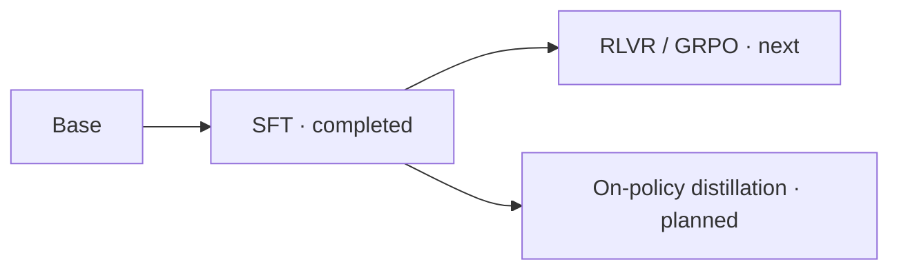

# Qwen3-0.6B-Base Post-Training

A small, reproducible GSM8K experiment comparing **base, SFT, SFT → RLVR, and SFT → on-policy distillation**. SFT is complete; the later branches start from the same SFT adapter.



## Results: SFT learns the task and answer format

Matched evaluation on **all 748 validation questions**: identical prompts and question order, greedy decoding, 512 new tokens maximum, batch 64, BF16 inference on the same H100. Dataset hashes and generation settings were checked. **The official test set remains untouched.**

| Model | Numerical accuracy | Unparseable final answer | Token-limit hits | Mean output tokens |
| --- | ---: | ---: | ---: | ---: |
| Base | 1.60% (12/748) | 98.26% (735/748) | 1.60% (12/748) | 235.8 |
| SFT | **61.63% (461/748)** | **1.20% (9/748)** | **0.67% (5/748)** | **96.7** |
| SFT → RLVR | Pending | — | — | — |
| SFT → on-policy distillation | Planned | — | — | — |


- **Formatting is a major part of the gain.** Scoring extracts the last parseable `<final>number</final>` tag and compares the normalized number exactly. The 60-point score increase cannot all be attributed to new mathematical ability. Invalid format means no parseable final answer; it does not enforce exactly one tag.
- **The remaining errors are mostly mathematical.** Of 287 SFT failures, 278 have parseable but incorrect answers. Ten inspected cases show incorrect relationships, percentage calculations, units, and multi-step bookkeeping.
- **Longer generation alone did not fix the base model.** Earlier 50-question probes at 256 and 512 tokens both scored 2%, with 98% invalid format. An earlier full Mac baseline scored 1.47%; the table uses the matched H100 rerun to reduce hardware/batching confounds.

## SFT training and resource use

Gold GSM8K reasoning supervises completion tokens only; questions are masked out of the loss. LoRA uses **rank 16, alpha 32, all eligible linear layers**, with frozen base weights. **torchao uses FP8 computations for eligible frozen base projections**; adapter operations and other computations retain higher precision. Saved adapters are evaluated on the ordinary BF16 base model.

The run used 300 optimizer steps, training/evaluation batches of 32, accumulation 1, a 512-token sequence limit, learning rate `1e-4` with linear decay, and no gradient checkpointing. Validation ran at step 0 and every 25 steps; training logs every 5; checkpoints every 100.


- Validation loss fell **0.6536 → 0.4977**, improving at every measurement, with diminishing gains and no validation-loss upturn during this run.
- Validation token accuracy rose **82.38% → 85.76%**. This is teacher-forced next-token prediction, not independently solved problem accuracy.
- Training took **239 seconds including validation/checkpointing**, covered about **1.42 epochs**, and peaked at **36.76 GiB allocated / 42.18 GiB reserved** on an H100 with 80 GB VRAM.
- The truncation audit found **zero truncated examples or lost final answers** in either split; the longest training sequence was 474 tokens.
- Active-compute samples reached 88–100% GPU utilization in the batch-32 pilot. Optimize examples/tokens per second rather than filling VRAM. Short pilots include warmup and are not controlled hardware benchmarks.

The [saved evidence](assets/sft-20261120/results.json) contains configuration/package versions, loss history, evaluation counts and confidence intervals, and ten failure examples. Training run: `sft-20261121-002201-0e7388`; matched evaluation: `results/sft-20261121-002201-0e7388-e87511` in the Modal Volume. Run-name timestamps are UTC.

## Data and comparison rules

- **Train:** 6,725 examples, 90% of official GSM8K training data, shuffled with `seed=42`.
- **Validation:** the remaining 748 examples, used for debugging, checkpoint selection, and tuning.
- **Test:** the official test split, reserved for selected finalists. Use `--split test --max-samples 0` only after tuning; include confidence intervals when making final benchmark claims.

Keep prompts, answer parsing, decoding, and evaluation questions fixed across branches. An additional SFT continuation is a useful later control for separating a method's benefit from extra training. Validation results are development measurements, not final test scores.

## Run on Modal

From the repository root, use Python 3.12 and the shared `requirements.txt`:

```bash
uv pip install -r requirements.txt
uv run modal setup

# Three-step FP8 pilot: gradients, changed adapters, FP8 dispatch, save/reload.
uv run modal run scripts/modal_sft.py

# Full configuration used above.
uv run modal run scripts/modal_sft.py --full-run \
  --steps 300 --batch-size 32 --gradient-accumulation-steps 1 \
  --eval-batch-size 32 --eval-steps 25 --logging-steps 5 \
  --save-steps 100 --eval-on-start
```

The image reads `requirements.txt`; Linux installs torchao, while macOS skips it. Model downloads and initial data preparation run on CPU, then training runs on one H100. Local `data/gsm8k` seeds a new Volume when available; later jobs reuse the stored splits. Only scripts and prepared data are uploaded. Direct version pins are not a complete transitive lockfile.

Training and evaluation artifacts persist in the **`qwen3-gsm8k` Volume**. The launcher prints the download command:

```bash
uv run modal volume get qwen3-gsm8k outputs/RUN_NAME ./outputs/RUN_NAME
```

Defaults are train/eval batch 16, accumulation 1, checkpointing off; the command above explicitly selects 32. Use `--full-run --steps 20` for an unprofiled timing pilot, `--max-length` for sequence length, and `--gradient-checkpointing` when memory is constrained. Smoke tests override evaluation/logging intervals and are not throughput benchmarks.

Keep the terminal open for attached runs. Jobs have a one-hour training timeout, no configured application-error retries, and a two-second idle-container window. Completed jobs release compute; check the Modal app status if a client log-stream timeout leaves completion unclear.

## Evaluate and reproduce the plots

For local data preparation or single-model evaluation on a suitable device:

```bash
uv run python -m scripts.prepare_data
uv run python -m scripts.evaluate --split validation --max-samples 0 \
  --max-new-tokens 512 --adapter outputs/RUN_NAME --out results/sft_val.json
```

Omit `--adapter` for the base. Evaluation defaults to 200 questions and a 256-token output cap, so specify the settings above for the full comparison.

The matched Modal launcher runs both models on the same H100 and checks against the locally saved `results/base_val_full_512.json` dataset hash:

```bash
uv run modal run scripts/modal_evaluate.py --run-name sft-20261121-002201-0e7388
```

Download the evaluation directory printed by the launcher and the training adapter directory. Then regenerate PNG/SVG plots:

```bash
uv run python -m scripts.plot_sft_results \
  --history outputs/RUN_NAME/trainer_state.json \
  --base results/EVALUATION_DIRECTORY/base.json \
  --sft results/EVALUATION_DIRECTORY/sft.json \
  --out results/plots
```

## Next experiments

**RLVR / GRPO:** the existing trainer samples four completions per prompt and uses binary exact-match reward. Its current `beta=0` has no reference-KL penalty. Before scaling, inspect reward diversity, zero-variance groups, output lengths, and format validity; monitor policy drift.

**On-policy distillation:** planned. Sample trajectories from the student, score those same prefixes with a frozen teacher, and update the student's LoRA adapter using a distillation objective. The existing `generate_teacher_data.py` / `train_distill.py` scripts instead implement optional offline response distillation using verified teacher-written solutions from training prompts only.

## References

- [RLHF Book](https://github.com/natolambert/rlhf-book/tree/main/code)
- [TRL SFTTrainer](https://huggingface.co/docs/trl/main/en/sft_trainer) · [GRPOTrainer](https://huggingface.co/docs/trl/grpo_trainer)
- [Tinker on-policy distillation recipe](https://tinker-docs.thinkingmachines.ai/cookbook/recipes/distillation/)
- [FP8 training with Accelerate](https://huggingface.co/docs/accelerate/usage_guides/low_precision_training)
